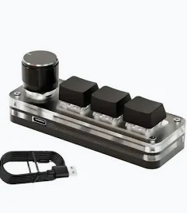
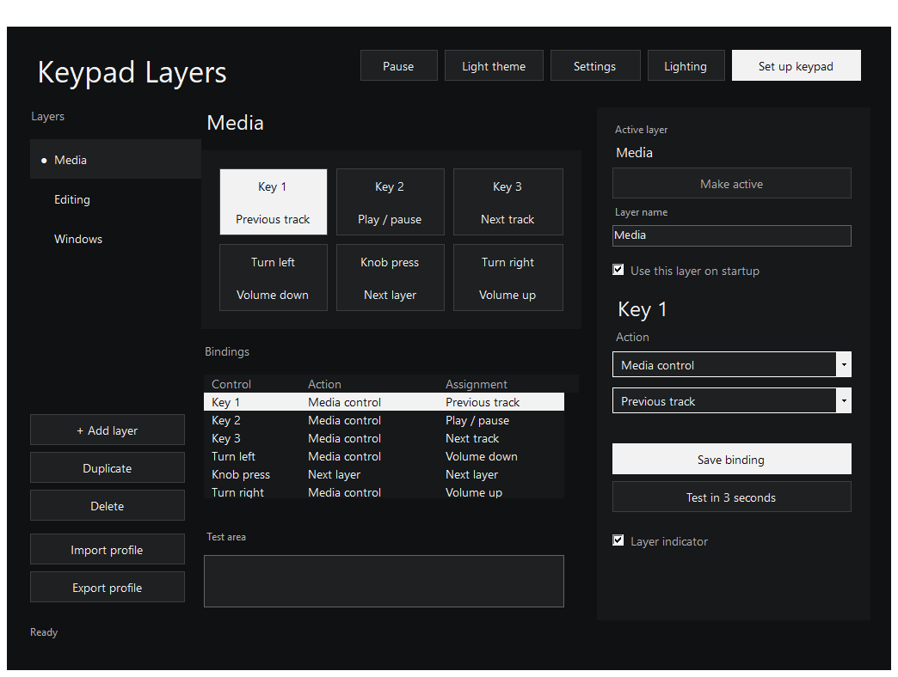
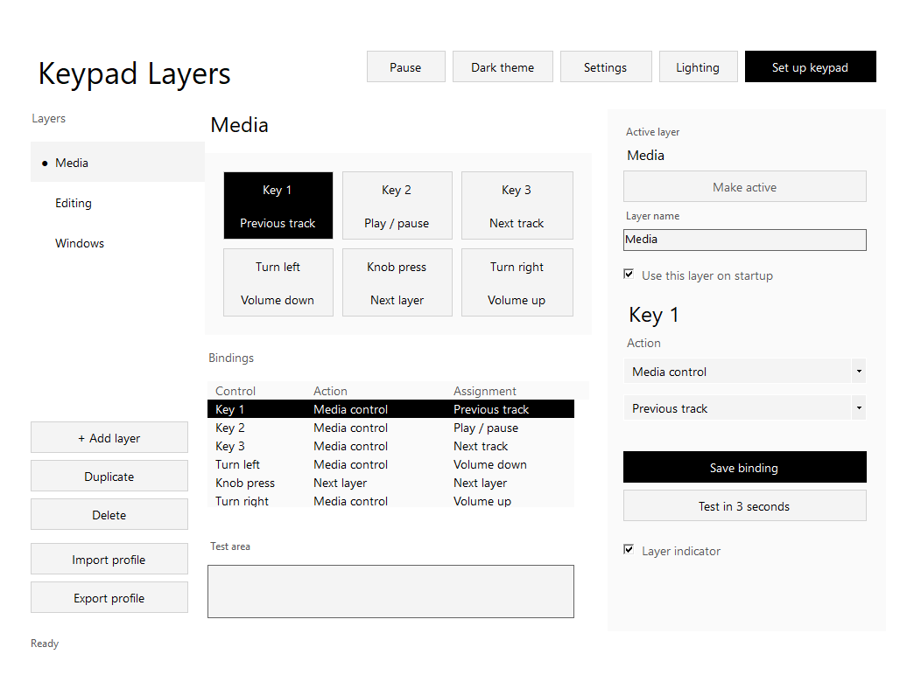

# Keypad Layers — AliExpress 3-Key Macro Keyboard Software for Windows


Free, open-source Windows software for the common **AliExpress 3-key, 1-knob USB macro keyboard**. Customize the three mechanical keys, rotary knob, and knob press with shortcuts, media controls, PowerShell commands, and software layers.

Designed for the **CH57x keypad with USB ID `1189:8890`**, often sold as a *3 key 1 knob macropad*, *mini keyboard*, or *programmable USB macro keypad*. It works with the stock firmware and provides an alternative to the vendor's **MINI KeyBoard** software for this supported layout.

[Download the latest release](https://github.com/Cesarsk/keypad-layers/releases/latest)

## Is this your AliExpress macropad?



This is the common three-key, one-knob design the app targets. Sellers use different names and similar cases for different hardware, so check the USB ID as well as the appearance. The supported device is **`VID_1189` / `PID_8890`**, connected by USB.

In Windows **Device Manager**, open the keypad's device properties, select **Details → Hardware Ids**, and look for `VID_1189&PID_8890`.

## Features

- Assign shortcuts, text, media controls, apps, URLs, and custom commands.
- Add, rename, duplicate, and switch layers; up to 50 per profile.
- Assign next-layer, previous-layer, or direct layer switching to any control.
- Light and dark themes inspired by [lucacesarano.com](https://lucacesarano.com).
- Tray controls, optional Windows startup, and optional minimized launch.
- Import/export JSON profiles and recover settings from a local backup.

| Dark | Light |
| --- | --- |
|  |  |

## Getting started

1. Download `KeypadLayers.exe` and keep it in a permanent folder. No runtime installation is needed.
2. Connect your keypad by USB and close the vendor's MINI KeyBoard app.
3. Open **Set up keypad**. Review the six signals before writing them. This replaces hardware layer 1; note your previous mappings first because this model has no reliable readback in the app.
4. Select a layer, select a control, choose an action, and click **Save binding**.

The default knob press cycles **Media → Editing → Windows**. The sidebar selects the layer being edited; **Make active** selects the layer that actually handles input.

Keep the app running for software layers. Closing the editor hides it in the system tray. Double-click the tray icon to reopen it; use **Quit** to exit.

### Commands

Choose **Run command**, paste the full command line, optionally set a working directory, and choose **Run hidden**. Arguments are passed directly to the executable, preserving PowerShell quoting and `$` expressions. Put executable paths containing spaces in double quotes.

Example:

```text
"C:\Program Files\Example\tool.exe" --profile "Editing profile"
```

For a PowerShell script, use the full `powershell.exe` path followed by your switches and `-Command "..."`. The application does not add a shell around the command. To use shell operators, explicitly invoke the desired shell. A command only runs when its assigned control is pressed or its test is triggered.

### Startup and theme

Open **Settings** for **Start with Windows** and **Start minimized to tray**. Startup registers only this app under the current user's Windows Run key; it needs no administrator permission. Disabling the option removes that entry. Keep the EXE at its chosen path after enabling startup. If you move it, enable startup again from the new location.

Use the theme button or Settings to choose light or dark. Preferences persist between launches. Importing a profile preserves local startup and theme preferences.

## Compatibility

This release targets the confirmed three-key/one-knob layout. USB IDs are shared by other products, so setup also checks interface 1 and the HID output-report descriptor and asks you to confirm the layout.

| Control | Input signal |
| --- | --- |
| Key 1 | F13 |
| Key 2 | F14 |
| Key 3 | F15 |
| Knob left | F16 |
| Knob press | F17 |
| Knob right | F18 |

You can make these assignments yourself in the vendor tool instead of using the setup screen. F13–F18 are reserved globally while the app listens, including those keys on another keyboard.

Layer switching does not write device flash. One-time setup changes only hardware layer 1; other hardware layers and lighting are left alone. No firmware replacement or custom USB driver is installed.

Generated input is subject to Windows permissions: controlling an administrator app may require running Keypad Layers at the same permission level. Shortcuts use the active Windows keyboard layout.

## Settings and profiles

Settings live at `%LOCALAPPDATA%\KeypadLayers\settings.json`. The previous valid file is saved as `.bak`. Recovery preserves invalid files with a timestamp. Profiles contain user-created mappings, including any custom command text; review them before sharing.

## Frequently asked questions

### Can I add layers to a 3-key macropad without a layer or Fn button?

Yes. Assign **Next layer**, **Previous layer**, or **Switch to layer** to a key or the knob press. These layers run in Windows, so Keypad Layers must stay open or in the tray.

### Can the knob control volume in one layer and shortcuts in another?

Yes. Each layer has separate assignments for clockwise rotation, counterclockwise rotation, and knob press, as well as the three keys.

### Does it work with every AliExpress mini keyboard?

This release supports the confirmed **three-key, one-knob CH57x `1189:8890`** layout. Other key counts, USB IDs, and lookalike boards need their own verification. The setup screen checks the device interface and output-report descriptor before offering to write settings.

### Do I need QMK or VIA?

No. This app uses the supported keypad's existing USB configuration protocol and keeps its stock firmware.

## Build and test

Requires Windows and the .NET 10 SDK. The application has no third-party runtime dependencies.

```powershell
./scripts/Publish.ps1
```

This builds a single portable EXE under `out/win-x64`, runs the automated checks, renders both themes, and writes build metadata and SHA-256 checksums. Tests cover layer routing, real editor/settings controls, persistence and recovery, startup registration in an isolated test key, hidden startup, command argument handling, harmless command execution, and USB report generation. They do not program a connected keypad or run the display-off command.

To run checks separately:

```powershell
dotnet build -c Release
dotnet publish -c Release -r win-x64 --self-contained true -p:PublishSingleFile=true -p:IncludeNativeLibrariesForSelfExtract=true -o publish
Start-Process ./publish/KeypadLayers.exe -ArgumentList '--self-test', './verification' -Wait
```

The application icon's source is `Assets/app.svg`. `scripts/Make-Icon.py` regenerates the PNG/ICO with Pillow.

## References

- [CH57x 8890 protocol](https://github.com/kriomant/ch57x-keyboard-tool/blob/master/src/keyboard/k8890.rs)
- [Windows SendInput](https://learn.microsoft.com/en-us/windows/win32/api/winuser/nf-winuser-sendinput)

MIT license. See [LICENSE](LICENSE).
